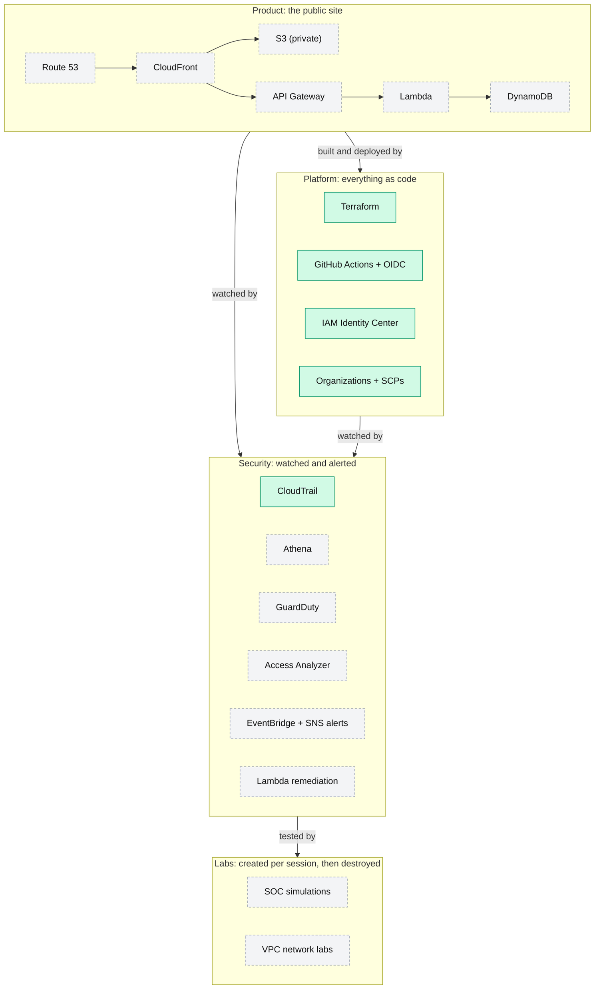

# aws-portfolio-lab

A personal AWS portfolio built as a security and cloud learning lab:
a public site protected, monitored and attacked in my own accounts,
all defined as code, for under $5 a month.

Status: work in progress. Live site: coming in Phase 2.

## Progress

| Phase | Focus | Status |
| --- | --- | --- |
| 0 | Account, budgets, repo, decisions | Done |
| 1 | Organization, identity, logging, pipeline | Done |
| 2 | Site on my own domain | In progress |
| 3 | Backend and log queries | Not started |
| 4 | Detection and first simulations | Not started |
| 5 | Network labs | Not started |
| 6 | Remediation, review, showcase | Not started |

## Target architecture

Green: built. Dashed grey: planned.

Built so far:

- Three-account AWS Organization (management, log-archive, workload)
  with deny-list service control policies
- IAM Identity Center sign-in, with no long-lived access keys
- Organization CloudTrail trail delivering to a protected log-archive
  bucket
- Account-level S3 Block Public Access in every account
- Terraform in two layers, with a GitHub Actions pipeline that signs in
  to AWS through OIDC

## Repository map

- `docs/architecture/decisions/` - decision records and index
- `docs/runbooks/` - bootstrap, deploy and recover (destroy comes with
  the labs)
- `docs/templates/` - decision record, detection write-up and lab report
  templates
- `docs/detections/` - detection write-ups (from Phase 4)
- `docs/network-lab/` - lab reports (from Phase 5)
- `docs/cost-log.md` - monthly spend against the $5 goal
- `docs/exam-mapping.md` - AWS exam domains mapped to what is built here
- `infrastructure/foundation/` - Terraform for the management and
  log-archive accounts and the pipeline roles; applied from my laptop
- `infrastructure/workload/` - Terraform for the workload account;
  applied by the pipeline
- `site/` - website source (from Phase 2)
- `lambda/` - backend and automation code (from Phase 3)
- `.devcontainer/` - the development environment
- `.github/workflows/` - the Terraform pipeline

## How changes are deployed

- Workload layer: a pull request runs a secret scan, format and
  validation checks and a plan; merging to `main` applies it.
- Foundation layer: reviewed by pull request, checked by format and
  validation, and applied by me from the dev container, because it holds
  the organization guardrails and the pipeline's own roles.
- Why two layers: see the decision records and `docs/runbooks/deploy.md`.

## Working with this repo

Development happens in a dev container (`.devcontainer/`) with pinned
tool versions. AWS access uses IAM Identity Center sign-in; no access
keys are stored. See `docs/runbooks/bootstrap.md` for the manual setup
steps (state bucket, foundation layer and the pipeline roles).

## Cost

Goal: at or under $5 a month. Tracking in `docs/cost-log.md`.

## Security

- No secrets are committed; gitleaks runs before every commit and in CI,
  and GitHub secret scanning with push protection is on.
- The pipeline uses short-lived OIDC credentials. The roles trust only this
  repository, pinned by its numeric IDs: pull requests assume a read-only
  plan role, and the `main` branch assumes the apply role.
- `main` is protected: changes need a pull request and passing checks.
- Account IDs, emails and ARNs are replaced with placeholders in the docs.

## License

MIT